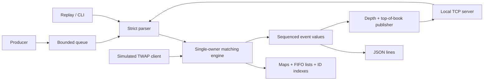

# ApexMatch

A deterministic C++20, single-instrument limit order book and matching simulator.
It includes complete matching, cancellation, replay, market data, a bounded
producer/consumer pipeline, a localhost TCP interface, and a simulated TWAP
client. It is intended for studying systems engineering and discussing quant
developer interviews. It has no brokerage connection or real-order capability.

All features are implemented. The engineering audit passed all six test groups
with native Clang Debug, Release, and ASan/UBSan. Native GCC 16.2 builds but fails
the mandatory pool-allocation-failure test in its standard library; the full
compiler matrix is not green. Linux/WSL2, TSan, leak detection and hosted CI
remain unverified. Consult [verification](docs/verification.md) and the
[isolated runtime issue](docs/toolchain-issue.md) before describing release status.

## Start here

Read [the completed-code study guide](docs/study-guide.md), beginning with
section 1, then replay `examples/sample.txt` while following
`MatchingEngine::add`. The guide explains each component's source, data
structures, C++ concepts, worked examples, tests, complexity and interview points.

* [Behavior, ownership and algorithms](docs/design.md)
* [Pipeline, market data, TCP and TWAP](docs/extensions.md)
* [Correctness and independent reference model](docs/testing.md)
* [Benchmark methodology and measured experiment](docs/performance.md)
* [Interview questions with substantive answers](docs/interview.md)
* [Verification record and environment limitations](docs/verification.md)
* [Engineering audit and release report](docs/audit-report.md)
* [Interview walkthrough](docs/project-walkthrough.md), [20 demanding questions](docs/interview-practice.md), and [resume notes](docs/resume-notes.md)

## Build and test on Linux / WSL2

Use Ubuntu 24.04 or another environment with GCC 12+ or Clang 16+, CMake 3.21+,
Ninja, and Python 3. Python is used by test/benchmark tooling, not the engine.
There are no downloaded C++ dependencies. The small test framework throws on
failure in debug and release builds; it is not disabled by `NDEBUG`.

```sh
sudo apt-get update
sudo apt-get install -y g++ clang cmake ninja-build python3
cmake --preset release -DCMAKE_CXX_COMPILER=clang++
cmake --build --preset release --parallel
ctest --preset release
```

For a debug build, substitute `debug`. A build directory remembers its compiler;
choose a fresh directory when switching compilers. All paths below are relative
to the repository root. On Windows, WSL2 runs these commands inside Ubuntu.
Native Windows LLVM-MinGW instructions are in [verification](docs/verification.md).
Compiler versions above are language/build minimums, not claims that every
runtime was tested. The tested GCC 16.2/libstdc++ resource-exhaustion failure
remains open, and the Linux matrix has not run on this machine.

```sh
# AddressSanitizer + UndefinedBehaviorSanitizer, including Linux leak detection
cmake --preset asan -DCMAKE_CXX_COMPILER=clang++
cmake --build --preset asan --parallel
ctest --preset asan
# Native Windows uses: ctest --preset asan-windows (unsupported leak check off).

# ThreadSanitizer must have its own build, separate from ASan.
cmake --preset tsan -DCMAKE_CXX_COMPILER=clang++
cmake --build --preset tsan --parallel
ctest --preset tsan
```

The [GitHub Actions workflow](.github/workflows/ci.yml) defines Linux GCC/Clang
debug, release, ASan/UBSan and separate Clang TSan jobs. The workflow is supplied;
no remote CI run is claimed by this local delivery.

## Architecture



`include/apexmatch/engine.hpp` defines `Order`, `Trade`, `OrderBook`,
`MatchingEngine`, `OrderEvent`, and `OrderValidator`. `src/engine.cpp` owns all
book mutation. Parsing/presentation are in `src/protocol.cpp`. Library code is
separate from programs in `apps/`; extensions are in `src/extensions.cpp`.

## Replay and commands

```sh
build/release/apex_cli --check examples/sample.txt
build/release/apex_cli --pool --check examples/sample.txt
printf 'ADD 1001 BUY 10500 10\nADD 1002 SELL 10400 4\nBOOK\nCANCEL 1001\nSTATS\n' | build/release/apex_cli
```

The case-sensitive grammar is:

```text
ADD <nonzero-uint64-id> BUY|SELL <positive-int64-price> <positive-int64-quantity>
CANCEL <nonzero-uint64-id>
BOOK
STATS
```

Fields are separated by spaces/tabs; CRLF is accepted. Blank lines and lines
whose first non-whitespace character is `#` are ignored. Trailing fields and
inline comments are rejected. Decimal integers cannot have a leading `+`.
Lines are limited to 4096 bytes, excluding LF. File replay accepts a final line
without LF. `BOOK` returns the top ten levels per side. The library offers any
requested depth, total quantity at a price, active count, order lookup, and
optional best bid/ask; an empty side has no best price.

Output is newline-delimited JSON, with no wall-clock fields. The checked
[sample input](examples/sample.txt) and [expected output](examples/sample.expected.jsonl)
show acceptance, executions, absolute level updates, cancellation and rejection.
Every mutation request, including rejection, has a request sequence. Each
engine event has an event sequence; each trade has an execution sequence.
Queries consume none. Accepted orders retain the request sequence as arrival.
ADD emits acknowledgement, then execution/update pairs, then an incoming
remainder update. CANCEL emits cancellation then update. Rejection emits one
event and preserves book state. See the exact [event contract](docs/design.md#sequences-and-exact-event-order).

Generate larger files independently of the core benchmark:

```sh
python3 tools/generate_stream.py --events 100000 --seed 42 --output build/workload.txt
build/release/apex_cli build/workload.txt > build/replay.jsonl
```

## Pipeline, TCP and TWAP examples

```sh
build/release/apex_pipeline --capacity 64 examples/sample.txt > build/pipeline.jsonl
cmp build/pipeline.jsonl examples/sample.expected.jsonl

# Terminal 1: binds to loopback only.
build/release/apex_server --port 9000
# Terminal 2: subscribes, submits commands, queries, and shuts the simulator down.
build/release/apex_client --port 9000 examples/network.txt

build/release/apex_twap --quantity 23 --slices 5 --start 0 --end 100 \
  --side BUY --price 101 --first-id 1000 --market examples/twap_market.txt
```

The pipeline preserves command order, blocks on full capacity, closes and
drains, and gives one thread ownership of the engine. Queue scheduling statistics
go to stderr, separate from deterministic stdout.

The TCP protocol frames requests/replies by newline and groups command replies
with `RESPONSE_END`. It supports partial reads/writes, subscriptions, bounded
connection buffers, slow-peer disconnection, half-close, and graceful shutdown.
`MD_LEVEL` is an absolute level replacement; `MD_TOP` and `MD_SNAPSHOT` are final
book checkpoints. A missing acknowledgement after disconnect does not imply
that a submitted order failed. See [protocol and limits](docs/extensions.md).

TWAP uses integer simulated time, never sleeps, and submits child sizes
`[5,5,5,4,4]` at `[0,25,50,75,100]`. Its constant limit is 101. The example
submits 23, executes 13, and cancels 10 unfilled units at time 100. Completion
means the schedule and cleanup completed, not that all units traded.

## Matching and validation rules

* Buy limits cross asks at or below their limit; sells cross bids at or above.
  Best price wins, then earliest resting arrival. Trades use the maker's price.
* Partial makers keep priority. Positive taker remainders rest. Completed
  orders and empty price levels are removed. Cancel removes only open quantity.
* Prices and quantities are positive signed 64-bit integers. IDs and sequences
  are unsigned 64-bit integers. Accepted IDs are permanently retired after use;
  rejected IDs may be retried. Inactive cancellation is rejected.
* Lifetime accepted submitted quantity is capped at `UINT64_MAX`, before any
  matching or insertion, which bounds all unsigned aggregates and statistics.
  Sequence exhaustion throws before mutation. Allocation failure is fatal to
  the session; it does not offer transactional rollback.

The engine checks an uncrossed book, positive resting quantities, FIFO,
index/node correspondence, aggregate totals and global quantity conservation.
Tests also maintain an independent per-order ledger to detect overexecution.

## Containers and complexity

Baseline storage uses ordered PMR maps of prices, PMR FIFO lists at each price,
an active-order hash index storing list iterators, and an accepted-ID hash set.
Baseline PMR delegates to ordinary allocation; the optional pool changes only
the book allocator. Iterators and ownership are explained in [design](docs/design.md).

Let N be active orders, L relevant levels, K executions, and D requested depth.
Let A be lifetime accepted IDs. Under average hash behavior:

| Operation | Cost in this implementation |
|---|---|
| Rest a noncrossing order | O(log(L+1)) amortized, plus allocation |
| Match an incoming order | O((K+1) log(L+1)), including absolute-update map lookups and amortized level removals |
| Cancel | Expected O(log(L+1)): hash lookup, map lookup, constant-time list erase |
| Best bid/ask | O(1) |
| Quantity at a price | O(log L) |
| Top D depth | O(min(D,L)) per side, plus result allocation |
| Active-order count | O(1) |
| Enumerate orders | O(N log N), because output sorts by arrival |

Hash operations have pathological linear worst cases: active indexes scale
with N, and lifetime ID lookup/rehash can scale with A. Full invariant checks
are O(N) expected and allocate temporary storage; they are excluded from matching
timings. Total memory is O(N + L + A), where A is lifetime accepted IDs. Pool
memory may retain its high-water capacity until the engine is destroyed.

## Benchmarks and optimization

```sh
python3 tools/run_benchmarks.py --build-dir build/release \
  --output results/my-machine --repeats 3
# Linux only, with a kernel-compatible perf and sufficient permissions:
cmake --preset profile
cmake --build --preset profile --parallel
bash tools/profile.sh build/profile noncrossing 1000000 results/profile
```

The matrix covers six fixed-seed workloads at 10,000, 100,000, and 1,000,000
requests, with baseline and pool modes, warm-up, and three measured repeats.
Batch throughput and individually sampled latency use separate passes. Timed
work includes core matching and event-vector destruction, excluding parsing,
JSON, I/O, engine construction/destruction and invariants. Results include mean,
p50/p95/p99, timer-pair overhead, upstream allocation counts, and approximate
book memory; requested bytes are not process RSS.

The audited [machine-readable measurements](results/audit-native-clang23/results.json)
and [full comparison table](results/audit-native-clang23/summary.md) record the
machine, compiler, flags, seed and repeat spread. The initial run remains in
[historical results](results/native-clang23/README.md). Read
[the measured experiment](docs/performance.md) before interpreting the pool as
an improvement. The ordinary-allocation baseline remains the default.

On the audited Ryzen 5 6600H / Windows 11 / Clang 23 release run, the million-request
noncrossing workload measured **1.83 million requests/s baseline versus 3.07
million with pooling**. Its p99 was 800 ns versus 700 ns. Book upstream
allocations fell from 3,002,040 to 129, while peak requested book memory grew
from 147.34 to 199.41 MiB. Pooling had higher median throughput and memory in
all 18 pairs; p99 improved in 16 pairs and was unchanged in two. The original
run included a p99 regression and is preserved. Differences between the two
runs are not evidence that an audit change caused a speedup. Timers quantize
many samples to 100 ns; these are local observations, not exchange guarantees.

## Scope and limitations

One instrument; limit orders only; no replace/amend, market/IOC/FOK orders,
fees, credit checks, exchange protocols, durable recovery, live trading,
authentication, or distributed sequencing. The engine has one owner, and
queries need that same ownership discipline. Accepted-ID history grows for the
session. Fatal resource failures require discarding the session. A finite file
pipeline cannot cancel an OS-blocked generic stream read. TCP connections have
bounded application buffers, but book size and per-command execution work are
not capped by those buffers. Cross-client network timing is nondeterministic;
ordered engine replay is deterministic. These are documented educational
tradeoffs, not production-exchange guarantees.

The [verification report](docs/verification.md) explicitly separates checks run
here from Linux-only checks still requiring another environment.
The MIT license was explicitly confirmed during this audit. No GitHub
repository has been created or pushed; [publication approval](docs/release-preparation.md)
and unresolved verification are separate from implementation completeness.
