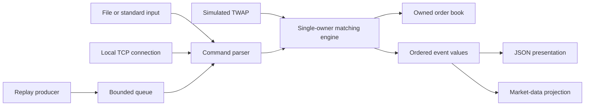

# Design and behavior contract

ApexMatch is one deterministic limit-order market for one unnamed instrument.
There is no real money, broker connection, market-data feed, authentication,
instrument routing, or trading recommendation. The engine is a mechanism;
the TWAP program is an example strategy using that mechanism.

## Domain vocabulary

* A **limit buy** sets the highest acceptable price; a **limit sell** sets the
  lowest acceptable price. The unexecuted remainder can rest in the book.
  A **market order** would request immediate execution without a limit, with
  potentially substantial slippage; this simulator does not implement it.
* A **bid** is a resting buy; an **ask** is a resting sell. The best bid is
  the highest bid, and the best ask is the lowest ask. Either can be absent.
* The **spread** is best ask minus best bid when both exist. It is strictly
  positive after a completed request here. Code does not subtract prices to
  decide compatibility, so signed subtraction cannot overflow.
* **Depth** aggregates open quantities and order counts at successive prices.
  Displayed depth does not imply future execution or hidden liquidity.
* **Price-time priority** chooses the best eligible price, then the earliest
  arrival at that price. The resting **maker** supplies liquidity. The incoming
  **taker** consumes it. A single incoming order can be a taker and then rest
  its remainder as a maker.
* A **partial fill** executes less than an order's remaining quantity. A maker
  keeps its arrival sequence and queue position after a partial fill.
* An **order ID** identifies one accepted order for its whole lifetime. An
  **execution ID** (`execution_sequence`) identifies one maker/taker execution;
  sweeping three makers produces three execution IDs, even at one price.

## Component boundaries

| Component | Responsibility and interface |
|---|---|
| `Order` | ID, side, limit ticks, remaining quantity, immutable arrival sequence. A value copied for queries. |
| `Trade` | Immutable execution value: execution sequence, buy and sell IDs, maker price, quantity. |
| `OrderValidator` | Stateless domain checks; `validate` returns an empty string or a stable error code. |
| `OrderBook` | Owns price levels, FIFO orders, the active index and lifetime accepted IDs; read-only query surface. |
| `MatchingEngine` | Sole mutation authority: `add`, `cancel`, `reject`, statistics and invariant checks. |
| `OrderEvent` | Value representing an acknowledgement, rejection, execution, cancellation or absolute level update. |
| Protocol | `parse_command`, `apply_command`, JSON presentation via `process_line`. No matching in the parser. |
| Extensions | Bounded handoff queue, market-data projection, localhost line protocol, simulated TWAP. |

Public core interfaces are in `include/apexmatch/engine.hpp` and
`include/apexmatch/protocol.hpp`. Applications are thin adapters.



## Ownership, mutation and lifetime

Each engine owns exactly one book. Each side is an ascending ordered map from
price to `Level`. Bid queries traverse it in reverse; asks traverse forwards.
Each level owns a FIFO `std::pmr::list<Order>` and an aggregate `uint64_t`.
The active hash index maps ID to side, price and list iterator. It neither owns
an order nor duplicates its mutable quantity. A separate accepted-ID hash set
retains IDs after completion/cancellation, enforcing the reuse policy.

Map insertion does not invalidate existing iterators. List insertion does not
invalidate existing element iterators. List erasure invalidates only the erased
element; the active entry is removed as part of the same request. Erasing an
empty map level invalidates that map iterator, and code never uses it afterward.
Hash rehashing can invalidate hash iterators, but the stored list iterators stay
valid. The engine does not keep hash iterators across insertion/rehash.

Queries return independent values (`optional`, vectors), not borrowed order
pointers. Applications cannot mutate a book through `engine.book()`.
The engine/book cannot be copied; iterator-bearing state must not be shallowly
copied. The pool resource, if enabled, is declared before all allocator-aware
containers, so reverse member destruction destroys the containers before the
resource. Both allocation modes have identical matching logic.

## Validation, identity and integer boundaries

| Input or condition | Policy |
|---|---|
| ID zero | `invalid_id`; IDs otherwise cover 1 through `UINT64_MAX`. |
| Price or quantity <= 0 | `invalid_price` / `invalid_quantity`. |
| Price or quantity > `INT64_MAX` | Parser `invalid_integer`; the typed API cannot represent it. |
| Invalid typed `Side` value | `invalid_side`. |
| Previously accepted ID | `duplicate_id`, including completed and cancelled orders. |
| Rejected ID | Not reserved; a corrected submission can use it. |
| Cancel ID zero | `invalid_id`. |
| Unknown/completed/already cancelled cancel target | `inactive_order`. No historical execution changes. |
| Malformed command or trailing fields | `malformed_command`. |
| Nondecimal, leading `+`, overflow or unsigned negative ID | `invalid_integer`. |
| Raw line longer than 4096 bytes, excluding LF | `line_too_long`; CR counts toward the bound. |
| Sum of lifetime accepted submitted quantity would exceed `UINT64_MAX` | `quantity_overflow`, before insertion or fills. |

`Price` and per-order `Quantity` are signed 64-bit integers to allow typed
validation of negatives. An execution quantity is the minimum of two positive
remaining quantities, so subtraction is safe. No price multiplication or
notional arithmetic is used. Aggregate and statistical quantities use unsigned
64-bit integers. The conservative lifetime submitted-quantity cap bounds every
aggregate, resting sum, cancelled sum and twice the total traded quantity.
It still permits a price level to exceed `INT64_MAX`. Cancelling does not restore
the lifetime budget. A long-lived process eventually must start a new session.

The request, event and execution sequences are unsigned 64-bit integers. Before
a request mutates anything, the engine reserves sequence space conservatively
for `2 * active_orders + 3` events and up to `active_orders` executions. Exhaustion
throws `overflow_error` before mutation. Counters cannot silently wrap. This
bound may refuse a request earlier than strictly necessary near exhaustion.
There is no public test-only way to fast-forward sequences to their maximum.

A normal rejected request changes only request/rejection statistics and its
rejection event, never orders, FIFO position or the accepted-ID registry.
Allocation failure or another unexpected C++ exception is a fatal session
error: adapters exit, and callers must discard the engine rather than continue.
This project does not promise rollback after out-of-memory failure.

## Matching and cancellation algorithms

An accepted incoming buy visits the lowest ask, stops if it exceeds the buy
limit, and executes against the front maker. A sell visits the highest bid,
stopping when it is below the sell limit. Execution price is always that
maker's price. After each fill the engine decrements both remaining quantities,
updates the maker level aggregate and conservation counters, removes a fully
filled maker from the active index and FIFO, and removes an empty level.
Repeat until the incoming order is exhausted or the best opposite price is
ineligible. Append a positive incoming remainder to its own price FIFO.

Cancellation looks up the order by ID, finds its map level, subtracts only its
remaining open quantity, erases the list node and active index entry, then
removes an empty level. It does not alter trades or release the ID for reuse.

## Sequences and exact event order

`add`, `cancel`, and explicit parser `reject` each consume one request sequence,
including rejections. The accepted order's arrival sequence is that request
sequence. Queries and ignored input consume none. Every emitted engine event
gets the next event sequence; every execution gets the next execution sequence.

For ADD:

1. `accepted` with the original requested quantity.
2. For each maker fill, `execution`, then `book_update` for that opposite price.
3. If an incoming remainder rests, one `book_update` for its own price.

For successful CANCEL: `cancelled` with the quantity removed, then `book_update`.
A rejection emits exactly one `rejected`. The level update is an **absolute**
quantity and order count; zero quantity/orders means remove that level. If two
makers share a price, two updates to the same price can occur in one request.
Events describe transitions; delivery of the returned vector occurs after the
whole request. A query at that time observes the final state, not each transient
state. Market-data publication must respect that distinction.

No wall-clock time, hash iteration order or pointer address appears in output.
The order enumeration query sorts by arrival sequence. Replay order is exactly
input order; simultaneous real network connections are sequenced by the server,
so cross-client arrival timing itself is outside deterministic replay.

## Worked examples

**FIFO and partial fill:** SELL 1 at 100 for 5, SELL 2 at 100 for 7, then BUY 3
at 101 for 8. Trade 1 buys 5 from order 1 at 100. Trade 2 buys 3 from order 2
at 100. Order 2 remains first at 100 with 4; order 3 is complete.

**Across prices:** SELL 10 at 102 for 3, SELL 11 at 100 for 2, SELL 12 at 101
for 4, then BUY 13 at 101 for 8. It executes 2 at 100, then 4 at 101. The 102
ask is ineligible, so BUY 13 rests 2 at 101. The book remains uncrossed.

**Cancellation:** Continue the FIFO example and CANCEL 2. Remove 4, publish a
zero update for ask 100, retain both earlier executions. A second CANCEL 2 is
`inactive_order`; ADD 2 is `duplicate_id`.

## Invariants and accounting

`OrderBook::check_invariants` checks positive quantities, nonempty levels,
strictly ordered prices, strictly increasing arrival sequences within FIFO,
correct side/price metadata, unique active IDs, index-to-node correspondence,
accepted-ID membership, level aggregate sums, and an uncrossed final book.
`MatchingEngine::check_invariants` checks statistics and:

```
submitted_quantity = 2 * traded_quantity + cancelled_quantity + resting_quantity
requests = accepted_ADDs + rejected_requests + successful_cancellations
```

The factor two counts the submitted buyer and seller units consumed in every
trade. The implementation expresses the equation using safe subtractions.
Tests independently track executions against each original order to ensure
positive fills and no overexecution. The simple reference model deliberately
scans a flat vector rather than repeating the indexed-map implementation.

## Complexity and memory

Let N be active orders, L the price levels on the relevant side, K maker fills
for the incoming order, and V exhausted price levels. Hash operations are
average O(1), worst O(N) under pathological collisions/rehashes. For practical
hash behavior, adding a noncrossing remainder takes O(log L), and cancellation
requires the average O(1) active lookup **plus O(log L) level lookup** and O(1)
list erase. FIFO append/erase is O(1). Matching does K fills, erases V levels,
and emits O(K) values. The current absolute-update helper looks up the changed
level in the map, so total matching cost is O(K log L + V + log L), under
average hash behavior, plus amortized vector growth and allocator costs.
It is deliberately not described as constant time per incoming order.

Best bid/ask uses map endpoints, O(1); a top-D depth query is O(min(D,L)) per
side plus output allocation. `quantity_at` is O(log L). Enumerating orders is
O(N log N); full invariants are O(N) expected and allocate temporary storage.
Neither is part of timed matching. A repeated ID registry has O(A) persistent
memory for A lifetime accepted IDs, in addition to O(N + L) active state.
Returned event storage is O(K), and a pool can retain high-water allocation
capacity after cancellation. Performance documentation measures that tradeoff.

## Concurrency boundaries and alternatives

The engine and its unsynchronized pool have one owning thread. A mutex and
condition-variable bounded queue hands work to that thread. There is no
concurrent book mutation or unsynchronized read of its containers. Queue
locking establishes the happens-before edge; no custom atomic memory order is
needed. Market-data values are copied outside the engine. The network event
loop also owns its engine on one thread. See [extensions](extensions.md) for
shutdown, backpressure, framing and simulated-time semantics.

Alternatives include contiguous price ladders for a bounded tick range,
intrusive queues to reduce allocation, slabs with generation-index handles,
flat hash tables, and lock-free SPSC queues. They constrain prices or lifetime,
add implementation risk, or require useful evidence before adoption. This
version preserves a clear baseline and changes only allocation policy for
its required optimization experiment.
